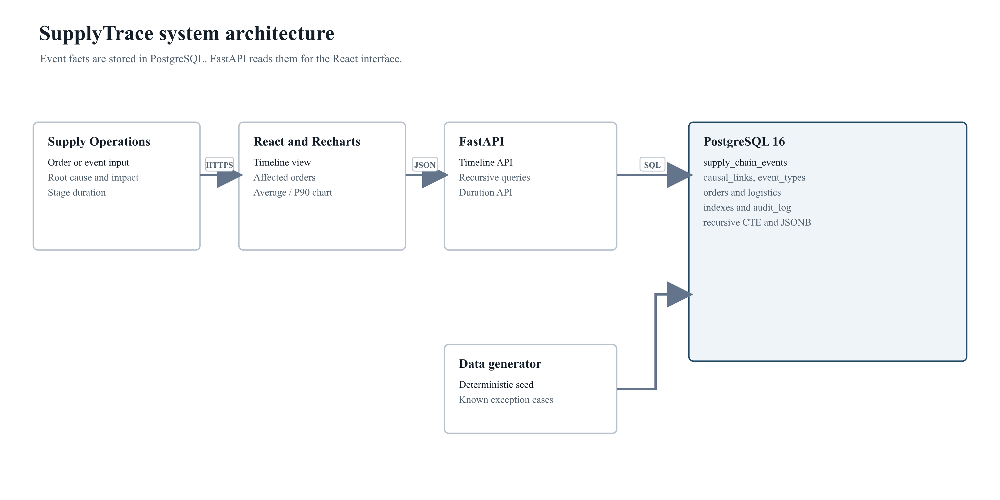
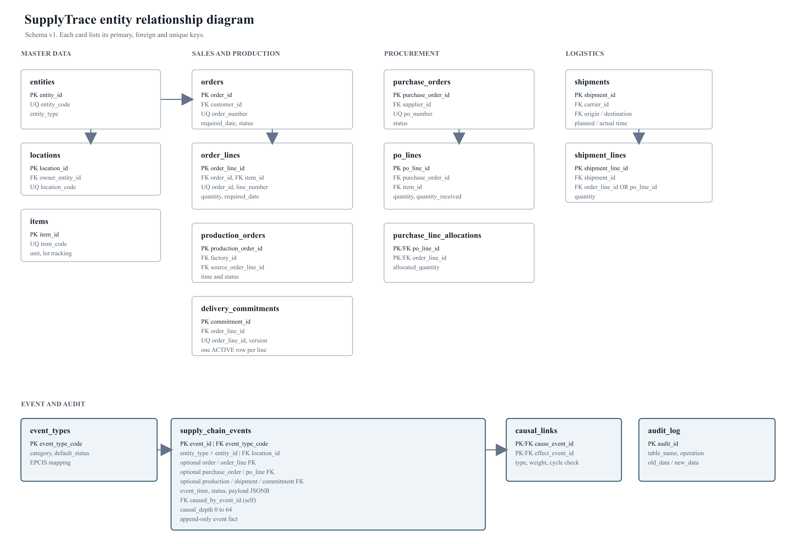
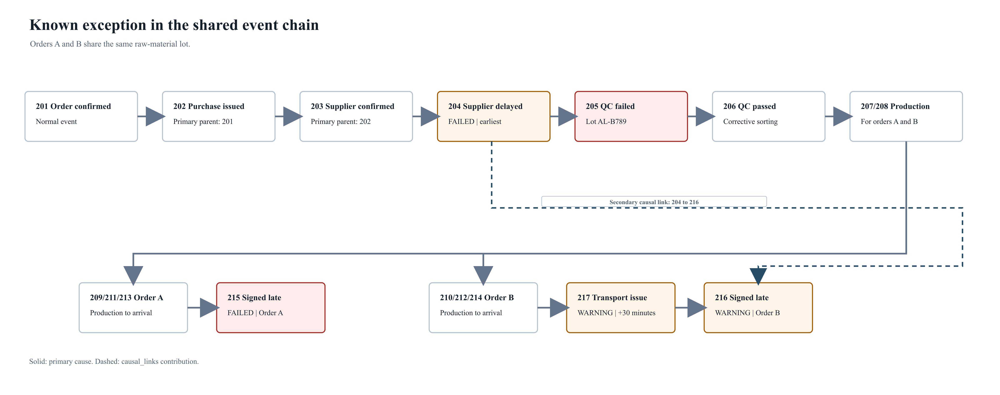

# SupplyTrace Part 1

## 需求说明

制造企业通常用 ERP、SRM、TMS 和 WMS 分别记录采购、供应、运输和仓储。订单延误后，运营人员仍要在多个系统中查找记录才能判断根因和受影响订单。

SupplyTrace 旨在把这些记录统一为供应链事件，并在 `supply_chain_events` 中保存直接上游事件。查询沿因果边遍历，不依赖人工拼接。目标用户和功能如下表所示。

| 用户 | 需求 | 数据库能力 |
| --- | --- | --- |
| 供应链运营人员 | 查看订单全过程，定位延误原因 | 订单时间线、反向根因链 |
| 交付经理 | 判断问题影响了哪些客户订单 | 正向影响遍历、当前交付承诺 |
| 生产计划人员 | 检查原料和质检问题对排程的影响 | 事件与订单行、生产工单关联 |
| 数据工程人员 | 生成并导入可复现数据 | 固定 schema、约束、事件类型字典 |

MVP 覆盖订单确认、采购、供应商确认、质检、生产、发运、到达和签收。范围包括单家企业及其一级供应商。系统不处理区块链共识、GPS 实时轨迹、IoT 接入、自动采购决策和细粒度权限。

## 3 Project Overview

### 3.1 Problem statement

现有系统能记录各环节状态，却缺少统一的因果边。订单交付异常发生后，班组需要人工核对订单、采购、质检、生产和运输记录。数据分散时，根因和影响范围都难以复现。

### 3.2 Application goals

系统提供四项查询：订单事件时间线、异常事件根因追溯、问题事件下游影响、各环节平均与 P90 耗时。主因果链使用自引用外键，补充的多父或贡献关系使用 `causal_links`。

### 3.3 Target users

主要用户是供应链运营人员和交付经理。生产计划人员与供应商质量工程师使用同一事件链查看上游异常。数据工程人员使用本阶段 schema 生成和导入测试数据。

### 3.4 MVP boundary

MVP 接受批量导入或 API 写入的事件。演示数据由固定随机种子生成，不使用真实企业数据。跨组织信任、实时定位和自动决策不在本阶段范围内。

## 4 Technical Design

### 4.1 Software architecture

数据层使用 PostgreSQL 16。FastAPI 提供查询接口，React 与 Recharts 展示时间线、因果路径和阶段耗时。数据生成器按业务顺序写入主数据、业务记录和事件。

图 4.1 系统结构

### 4.2 Technology stack

| 层次 | 技术 | 用途 |
| --- | --- | --- |
| 数据库 | PostgreSQL 16 | 外键、约束、递归 CTE、JSONB、窗口函数和索引 |
| 数据生成 | Python、Faker | 固定种子、异常场景和规模参数 |
| 后端 | FastAPI、Pydantic | 参数校验、查询接口和 OpenAPI 文档 |
| 前端 | React、Recharts | 四个视图、因果路径和耗时图 |

### 4.3 Data flow

生成器先写主数据和业务记录，再按拓扑顺序写入事件。数据库触发器检查父事件、父时间、因果深度和业务对象归属。后端只读取已提交事件，业务表状态由导入任务更新。

新增事件类型只需插入 `event_types`。新增固定查询字段需要 migration，并同步更新 ERD、数据字典和 API 模型。

## 5 Database Design

### 5.1 Design principles

业务表描述订单、采购、生产、发运和交付承诺之间的关系。事件表记录何时发生了什么、涉及哪个主体，以及由哪个上游事件触发。事件对业务对象使用显式外键，不使用一个通用字符串 ID 代替全部关系。

### 5.2 Entity relationship diagram

图 5.1 SupplyTrace Schema v1 ERD

`supply_chain_events` 是事实中心。`caused_by_event_id` 是自引用外键，`causal_links` 保存补充的多父、替代或纠正关系。`delivery_commitments` 保存交付日期的版本变化。

### 5.3 Table composition

| 分组 | 表 | 用途 |
| --- | --- | --- |
| 主数据 | `entities`、`locations`、`items` | 供应链主体、地点、原料和成品 |
| 订单 | `orders`、`order_lines`、`delivery_commitments` | 客户订单、需求和承诺版本 |
| 采购 | `purchase_orders`、`po_lines`、`purchase_line_allocations` | 采购头、采购行和订单行分配 |
| 生产 | `production_orders` | 计划、实际时间和状态 |
| 物流 | `shipments`、`shipment_lines` | 起终点、承运商和发运内容 |
| 事件与审计 | `event_types`、`supply_chain_events`、`causal_links`、`audit_log` | 事件定义、事实、补充因果边和快照 |

### 5.4 Keys and constraints

所有代理主键使用 `BIGINT GENERATED BY DEFAULT AS IDENTITY`。业务编号单独设置唯一约束。订单行必须属于关联订单，采购行必须属于关联采购单。

事件表只允许追加。触发器拒绝更新和删除，并要求父事件存在、父时间不晚于子时间、因果深度不超过 64。每条订单行最多有一个 `ACTIVE` 交付承诺，该规则由部分唯一索引保证。

### 5.5 Normalization and JSONB

主数据、订单头与明细、采购头与明细、发运头与明细按第三范式拆分。采购行到订单行的多对多关系由 `purchase_line_allocations` 保存。

`payload` 只保存批次号、检测项目、外部单号和纠正原因等随事件类型变化的字段。它必须是对象且不超过 32 KB。用于筛选、连接或约束的字段仍使用固定列。

### 5.6 Indexes

| 索引 | 字段 | 用途 |
| --- | --- | --- |
| `idx_events_caused_by` | `caused_by_event_id` | 反向根因递归 |
| `idx_events_entity_time` | `entity_type`、`entity_id`、`event_time DESC`、`event_id DESC` | 实体时间线 |
| `idx_events_type_time` | `event_type_code`、`event_time DESC`、`event_id DESC` | 事件类型筛选 |
| 局部时间索引 | 订单行、订单、采购行、发运记录及事件时间 | 业务对象时间线 |
| 异常事件索引 | `WARNING`、`FAILED` 事件 | 问题事件列表 |

查询性能由 Part 3 使用 `EXPLAIN ANALYZE` 验证。Part 1 不声明尚未测得的性能结果。

### 5.7 Sample queries

`supplytrace_sample_queries.sql` 包含四类查询。递归查询保存已访问路径并限制深度 64。时间相同时使用 `event_id` 作为第二排序键。影响分析同时遍历 `caused_by_event_id` 和 `causal_links`，再通过订单行外键返回受影响订单。

| 页面 | 输入 | 数据来源 |
| --- | --- | --- |
| 事件时间线 | 订单号 | `orders`、`order_lines`、`supply_chain_events`、`event_types` |
| 根因追溯 | 异常事件 ID | `caused_by_event_id`、事件状态和时间 |
| 影响传导 | 问题事件 ID | 主因果边、`causal_links`、订单行和活动交付承诺 |
| 环节耗时 | 订单行集合 | 阶段事件时间、窗口聚合和 P90 |

## Appendix A Sample Data and Verification

固定场景包含两个订单，它们共用一条 60 kg 铝板采购行。供应商延误后首轮质检失败，复检通过后两条生产工单继续。订单 A 延误签收，订单 B 另受运输拥堵影响。

图 A.1 固定异常场景

| 检查项 | 预期结果 |
| --- | --- |
| 订单 A 时间线 | 11 条事件 |
| 事件 215 根因链 | 11 个节点，最早异常为事件 204 |
| 事件 204 影响范围 | 订单 A 和订单 B |
| 固定场景总量 | 17 条事件、1 个根事件、5 个异常事件 |
| 最大因果深度 | 10 |

验证使用 PostgreSQL 16.2 临时实例。Schema、样例数据、四类查询和完整性检查均执行成功。非法事件修改、时间倒序、因果环和重复活动承诺均被拒绝。
